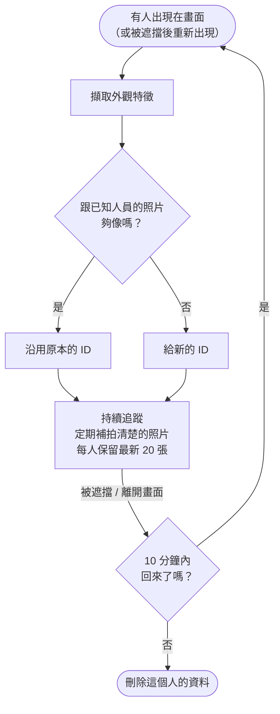
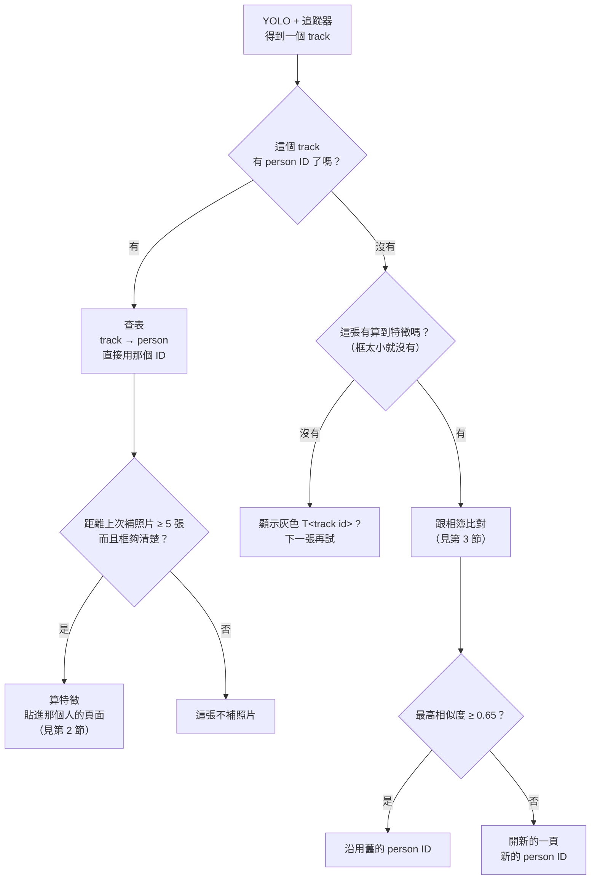
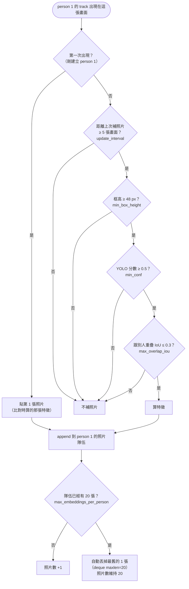
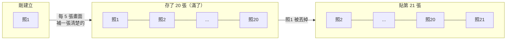
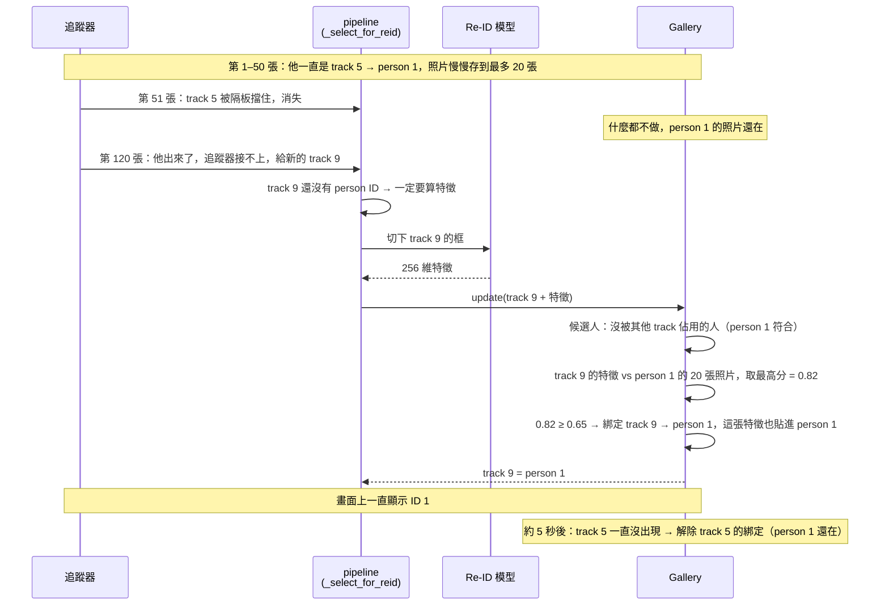
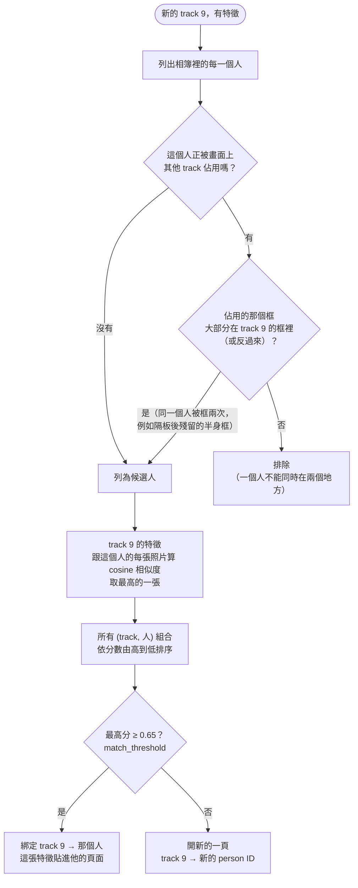
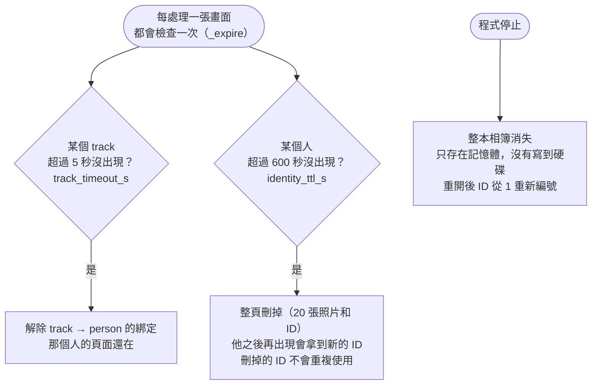

# Gallery 流程圖（單一攝影機）

以「相簿」來比喻：gallery 是一本相簿，每個人（person）一頁，每頁最多 20 張照片（Re-ID 特徵）。

程式碼位置：[gallery.py](person_pipeline/gallery.py)、[camera.py](person_pipeline/camera.py) 的 `_select_for_reid()`。參數在 [config.yaml](config.yaml) 的 `reid` 和 `gallery` 段落。

> 圖是用 Mermaid 畫的。GitHub 會直接顯示；在 VS Code 預覽（Ctrl+Shift+V）要先安裝擴充套件「Markdown Preview Mermaid Support」。

---

## 摘要：一張圖看懂

**一句話：** 每個人出現時比對一次外觀，認得就沿用舊 ID，不認得就給新 ID；之後持續更新他的照片，所以被遮擋或離開再回來，仍能認回同一個 ID。

以下是各步驟的細節。

---

## 1. 總覽：每張畫面、每個 track 怎麼處理

重點：**只有還沒有 person ID 的 track 才會比對。** 認出身分之後只會查表和補照片，不會再比對。

---

## 2. person 1 怎麼存到 20 張

### 2.1 什麼時候貼照片

三個「清楚」條件的原因：框太小特徵不準；分數低的框可能只框到一部分；跟別人重疊的照片會混到兩個人的外觀。

### 2.2 照片隊伍的變化

- 每頁永遠保留**最近的 20 張**，丟掉的一定是最舊的，不管照片好不好。
- 攝影機 15 fps、每 5 張補一張的話，20 張大約是最近 7 秒左右的外觀。常被擋住或跟別人重疊時，補得比較慢，涵蓋的時間比較長。
- 人不在畫面上時不會補照片，所以離開時的 20 張會原封不動留著。

---

## 3. track ID 換掉時怎麼比對

### 3.1 例子：被隔板擋住，track 5 變成 track 9

### 3.2 比對的詳細步驟

同一張畫面有好幾個新 track 時，從分數最高的組合開始配對，每個 track 和每個人都只能配一次，所以兩個新 track 不會搶到同一個人。

---

## 4. 什麼時候忘記

---

## 5. 參數對照

| 參數 | 預設值 | 在流程中的作用 |
|---|---|---|
| `reid.update_interval` | 5 | 已認出的人，每幾張畫面補一張照片 |
| `reid.min_box_height` | 48 | 補照片時，框至少要多高（px） |
| `reid.min_conf` | 0.5 | 補照片時，YOLO 分數至少多少 |
| `reid.max_overlap_iou` | 0.3 | 補照片時，跟別人重疊不能超過多少 |
| `gallery.max_embeddings_per_person` | 20 | 每頁最多幾張照片 |
| `gallery.match_threshold` | 0.65 | 新 track 要多像才沿用舊的 ID |
| `gallery.match_metric` | max | 跟每頁的照片比時，取最像的一張（`mean` = 跟平均值比） |
| `gallery.track_timeout_s` | 5 | track 消失多久後解除綁定 |
| `gallery.identity_ttl_s` | 600 | 人消失多久後整頁刪掉 |
